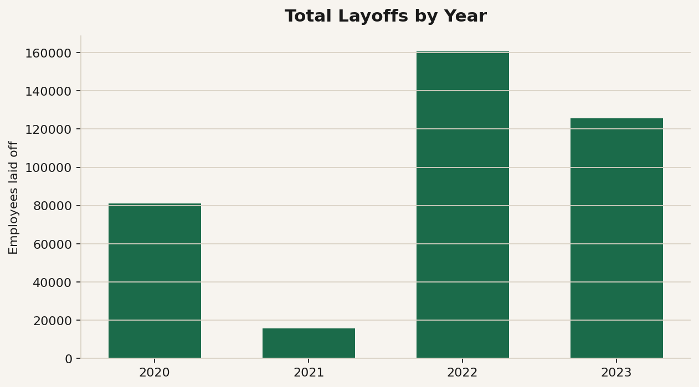
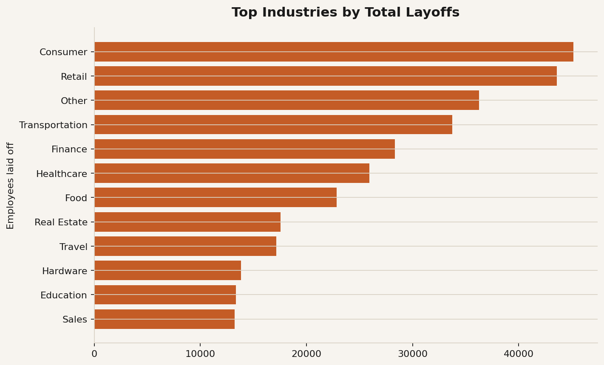
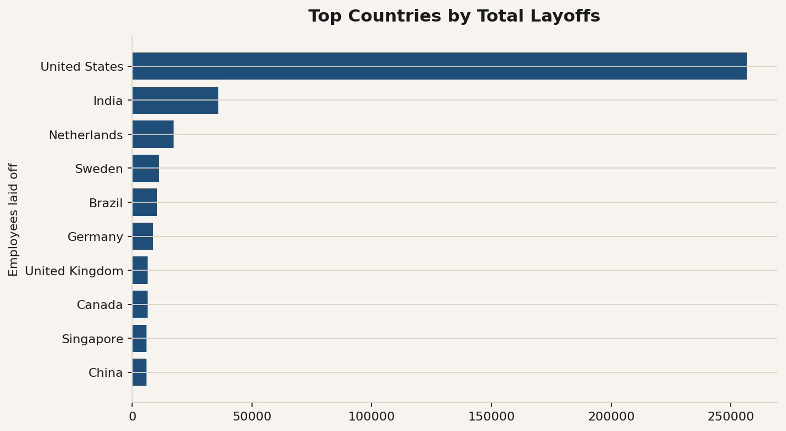
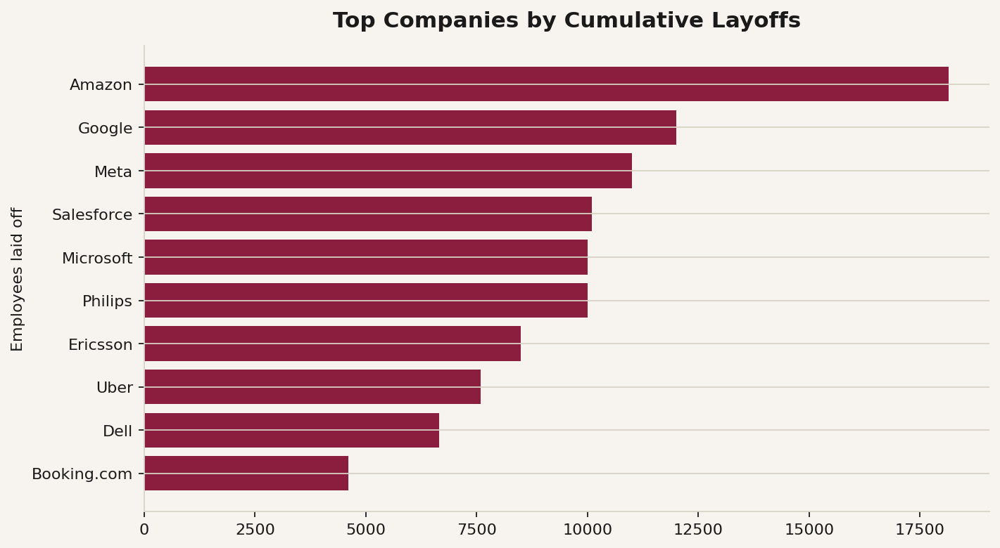
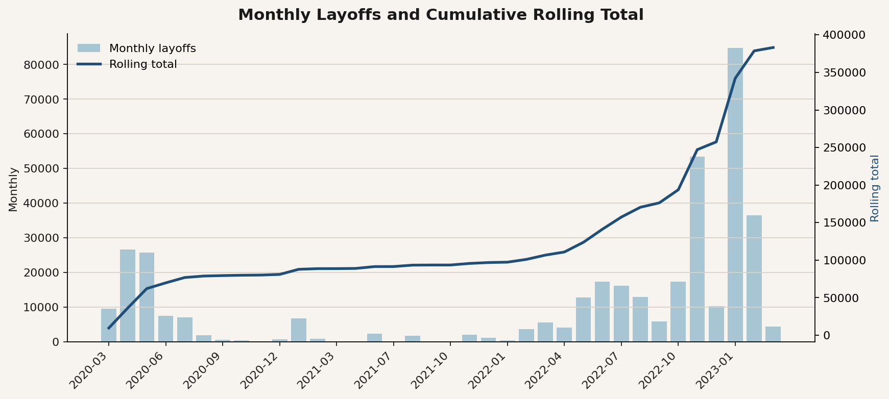
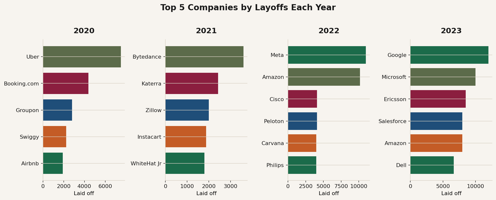

# World Layoffs — SQL Data Cleaning & EDA

MySQL portfolio project that cleans a messy world tech layoffs dataset, then explores trends across companies, industries, countries, and time.

**Dataset source:** [Alex The Analyst — layoffs.csv](https://github.com/AlexTheAnalyst/MySQL-YouTube-Series/blob/main/layoffs.csv) (mirrored in `data/layoffs.csv`)

---

## Project structure

```
World-Layoffs-SQL-Cleaning-and-EDA/
├── data/
│   └── layoffs.csv                 # Raw source (~2,361 rows)
├── sql/
│   ├── 01_setup.sql                # Create DB + raw table
│   ├── 02_data_cleaning.sql        # Staging, dedupe, standardize, nulls
│   └── 03_eda.sql                  # Metrics, aggregates, rolling totals, rankings
├── scripts/
│   ├── generate_eda_charts.py      # Export chart PNGs from cleaned table
│   └── measure_outcomes.py         # Before/after data quality + tested findings
├── outputs/
│   ├── images/                     # EDA chart PNGs
│   ├── *.csv                       # Query result exports + cleaned table
│   ├── cleaning_summary.txt
│   ├── measured_outcomes.md        # Output of measure_outcomes.py
│   └── eda_key_results.txt
└── README.md
```

---

## How to run

1. Start **MySQL / MariaDB** and open Workbench or the CLI.
2. Run `sql/01_setup.sql`, then load `data/layoffs.csv` into `world_layoffs.layoffs`.
3. Run `sql/02_data_cleaning.sql` → working table: `layoffs_staging2`.
4. Run `sql/03_eda.sql` for exploratory analysis.
5. (Optional) Generate charts:

```bash
pip install pymysql pandas matplotlib
python scripts/generate_eda_charts.py
```

6. (Optional) Measure outcomes from the CSVs (no database needed):

```bash
pip install pandas scipy
python scripts/measure_outcomes.py
```

---

## Cleaning results (executed run)

| Stage | Rows |
|-------|------|
| Raw `layoffs` | 2,361 |
| After dedupe + null cleanup (`layoffs_staging2`) | **1,995** |
| Date range | 2020-03-11 → 2023-03-06 |

Pipeline: staging → `ROW_NUMBER` dedupe → `TRIM` / Crypto consolidation / country trailing `.` / `STR_TO_DATE` → blank→NULL + industry self-join → drop rows missing both layoff metrics → drop `row_num`.

---

## Measured outcomes

From `scripts/measure_outcomes.py` (full report: [`outputs/measured_outcomes.md`](outputs/measured_outcomes.md)).

**Data quality, raw vs cleaned**

| Check | Raw | Cleaned |
|-------|-----|---------|
| Exact duplicate rows | 5 | 0 |
| Company names with extra whitespace | 11 | 0 |
| Non-standard industry labels | 3 | 0 |
| Countries with trailing `.` | 4 | 0 |
| Missing industry | 4 | 1 |
| No layoff count and no layoff % | 362 | 0 |
| **Rows with at least one defect** | **384 (16.3%)** | **1 (0.1%)** |

A pandas replay of the SQL rules gives the same 1,995 rows as the MySQL output.

**Tested findings**

- Seed–Series B startups cut a median **30%** of staff vs **11%** for Post-IPO companies (Mann-Whitney U, p < 1e-40), and were **~15x** more likely to shut down entirely (14.8% vs 1.0%).
- Funding raised vs % of staff cut: Spearman ρ = **−0.34** (n = 1,572).
- **54%** of all layoffs happened in six months (Oct 2022 – Mar 2023).
- **65 events** (4% of events) account for **48%** of all layoffs.

---

## Key EDA findings

| Insight | Result |
|---------|--------|
| Peak year | **2022** — 160,661 laid off |
| 2023 (partial through Mar) | 125,677 |
| Cumulative rolling total | **383,159** by 2023-03 |
| Top country | United States |
| Hardest-hit industries | Consumer, Retail, Other, Transportation, Finance |
| Top companies (cumulative) | Amazon, Google, Meta, Salesforce, Microsoft, … |
| 2020 top-5 | Uber, Booking.com, Groupon, Swiggy, Airbnb |
| 2022 top-5 | Meta, Amazon, Cisco, Peloton, Carvana/Philips |
| 2023 top-5 | Google, Microsoft, Ericsson, Amazon/Salesforce, Dell |

---

## Charts













---

## Skills demonstrated

- Staging tables and safe mutation patterns  
- Window functions (`ROW_NUMBER`, `DENSE_RANK`, rolling `SUM`)  
- CTEs for multi-step analysis  
- String / date cleanup (`TRIM`, `LIKE`, `STR_TO_DATE`)  
- Self-joins for imputation  
- Grouping and ranking for business insights  
